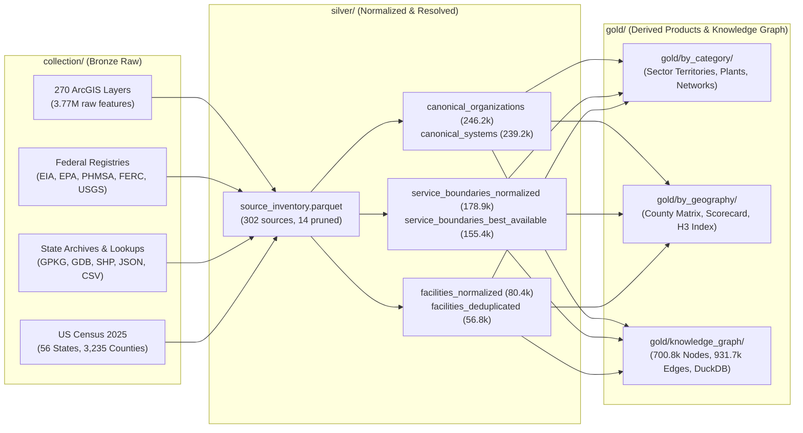

# U.S. Utility Data Harmonization, Entity Resolution & Materialized Knowledge Graph

> **Rebuild in progress:** The material below describes the legacy pipeline and
> its historical outputs. Raw data is no longer tracked in Git, and the prior
> Silver and Gold outputs have been moved under `UTILITYDATA_HOME/legacy`.
> See [rebuild setup](docs/rebuild-setup.md), the [source registry](registry/README.md),
> and [independent review gates](docs/review-gates.md) for the current work.
>
> The current platform is the `utilitydata` package. A release is built with
> `uv run utilitydata pipeline run --release-id <id>` and served locally with
> `docker compose up`. The [runbook](docs/runbook.md) covers both, including
> resume, the rules for which releases can be written, and the optional login.
> `run_pipeline.py` and `pipeline/` below are the legacy pipeline.

This repository collects, deduplicates, harmonizes, and materializes public U.S. utility, service-territory, and infrastructure data across **electric, natural gas, drinking water, wastewater, stormwater, telecommunications, and petroleum/liquids** into standardized **Silver** GeoParquet/Parquet tables and **Gold** derived data products, backed by an embedded **Materialized Knowledge Graph** (`gold/knowledge_graph/utility_knowledge_graph.duckdb`).

---

## Architecture Overview

The repository is structured as a four-layer data platform:

1. **Bronze — Source-Preserving Collection (`collection/`)**:
   - Contains **7,880+ raw source files (~11.8 GB)** acquired across 25+ collection batches (`collect.py`, `collect_gis.py`, `collect_round3_docs.py` through `collect_round25.py`), including **270 paginated ArcGIS feature layers** (`3,767,062` raw features), federal regulatory archives (EIA-861, EIA-860, EIA-860M, EIA-923, EIA-176/191, EPA SDWIS/ECHO, EPA ORD Public Water Service Areas v3.0, EPA CWNS 2022, EPA Sewersheds v1.3, PHMSA 2025 Pipeline Annual Reports, FERC CID & Forms 1/2/6/60/714, USACE NID, USGS USWTDB v9.1 & USPVDB v4.0, USBR assets), state GIS archives, county/community lookups, and 2025 U.S. Census TIGER cartographic boundaries.
   - See [`collection/README.md`](collection/README.md), [`collection/GAP_ANALYSIS.md`](collection/GAP_ANALYSIS.md), and [`collection/INVENTORY_REASSESSMENT.md`](collection/INVENTORY_REASSESSMENT.md) for source-by-source provenance, download manifests, and caveats.
2. **Declarative Source Catalog (`catalog/sources_catalog.yaml`)**:
   - Registers all **302 structured spatial and tabular sources** with standardized metadata (`sector`, `state`, `entity_category`, `zone_role`, `authority_tier` 1–5, `license_tier`, and explicit intra-source duplicate pruning rules).
3. **Silver — Normalized & Entity-Resolved Tables (`silver/`)**:
   - Decodes Esri `codedValues` domains, reprojects all geometries to **`EPSG:4326` (WGS84)** (and **`EPSG:5070` Conus Albers** for area math), validates polygon topology, dissolves multi-part/parcel-level records by `(provider, sector, state, zone_role)`, computes grid-snapped WKB SHA-256 geometry hashes (`geometry_hash`), links records to a canonical federal/state entity spine, and deduplicates physical facilities.
4. **Gold — Derived Data Products & Materialized Knowledge Graph (`gold/`)**:
   - Publishes ready-to-query derived datasets partitioned **by category** (`gold/by_category/`), **by geography** (`gold/by_geography/`, including a 3,235-county multi-utility matrix, state-by-sector coverage scorecard, and Uber H3 spatial index), and as a **Materialized Knowledge Graph** (`gold/knowledge_graph/kg_nodes.parquet`, `kg_edges.parquet`, and `utility_knowledge_graph.duckdb`).



---

## Repository Directory Structure

```text
.
├── README.md                           # Platform architecture, data dictionary, and usage guide
├── run_pipeline.py                     # CLI orchestrator for all pipeline stages & verification audits
├── catalog/
│   └── sources_catalog.yaml            # Declarative registry of 302 sources, authority tiers & pruning rules
├── pipeline/                           # Modular Python harmonization & entity-resolution package
│   ├── __init__.py
│   ├── config.py                       # USPS state/county normalizers, PWSID/ID helpers, legal name cleaners
│   ├── build_catalog.py                # Scans collection/data/ -> catalog/sources_catalog.yaml & silver/
│   ├── normalize_registries.py         # Extracts Census 2025 geographies, federal spines & county lookups
│   ├── normalize_spatial.py            # Reprojects, dissolves, and hashes GIS & vector layers
│   ├── entity_resolution.py            # Links boundaries/lookups/assets to canonical orgs/systems & deduplicates
│   └── build_gold_products.py          # Materializes category/geographic products, H3 index & Knowledge Graph
├── silver/                             # Standardized Parquet & GeoParquet tables (intermediate & canonical)
│   ├── source_inventory.parquet
│   ├── reference_states.parquet
│   ├── reference_counties.parquet
│   ├── federal_organizations_spine.parquet
│   ├── federal_systems_spine.parquet
│   ├── canonical_organizations.parquet
│   ├── canonical_systems.parquet
│   ├── county_utility_associations.parquet
│   ├── service_boundaries_normalized.parquet
│   ├── service_boundaries_best_available.parquet
│   ├── facilities_normalized.parquet
│   ├── facilities_deduplicated.parquet
│   └── linear_and_node_networks_summary.parquet
├── gold/                               # Production Derived Data Products & Materialized Knowledge Graph
│   ├── build_summary.json
│   ├── by_category/
│   │   ├── water_service_territories_best.parquet
│   │   ├── wastewater_service_territories_best.parquet
│   │   ├── electric_service_territories_best.parquet
│   │   ├── natural_gas_service_territories_best.parquet
│   │   ├── stormwater_and_multi_service_territories_best.parquet
│   │   ├── electric_generation_and_substations_dedup.parquet
│   │   ├── water_and_wastewater_facilities_dedup.parquet
│   │   └── linear_and_node_infrastructure_inventory.parquet
│   ├── by_geography/
│   │   ├── county_utility_service_matrix.parquet
│   │   ├── county_multi_utility_summary.parquet
│   │   ├── state_sector_coverage_scorecard.parquet
│   │   └── h3_spatial_index.parquet
│   └── knowledge_graph/
│       ├── kg_nodes.parquet
│       ├── kg_edges.parquet
│       └── utility_knowledge_graph.duckdb
└── collection/                         # Original source-preserving acquisition scripts & raw data
    ├── README.md                       # Detailed source provenance & limitations log
    ├── GAP_ANALYSIS.md                 # State-by-state acquisition gap analysis
    ├── INVENTORY_REASSESSMENT.md       # Stopping-point reassessment of raw collection
    ├── collect.py                      # Direct archive downloader
    ├── collect_gis.py                  # Paginated ArcGIS REST snapshotter (270 feature layers)
    ├── collect_round*.py               # Batch acquisition scripts (Rounds 3–25)
    └── data/                           # Raw archives, GIS snapshots (page_*.json.gz), and manifests
```

---

## De-Duplication & Harmonization Methodology

The pipeline (`pipeline/`) addresses four distinct levels of duplication and heterogeneity present in raw federal, state, and municipal utility data:

### 1. Intra-Source Subset & View Pruning (`pipeline/build_catalog.py`)
Fourteen sources in the raw collection are filtered views, centroid representations, or partial third-party subsets of other collected datasets. They are preserved in `collection/data/` for provenance but explicitly flagged with `is_pruned_duplicate = true` in `catalog/sources_catalog.yaml` and excluded from Silver/Gold aggregation:

| Pruned Source ID | Superseded By | Reason |
| :--- | :--- | :--- |
| `arizona_electric_utility_areas_dema_source` | `arizona_electric_utility_areas_dema` | Exact duplicate ArcGIS source layer (same 75 polygons and IDs) |
| `dc_water_large_mains` | `dc_water_pressure_mains` | Filtered $\ge 16\text{-inch}$ subset of `dc_water_pressure_mains` (7,471 overlapping mains) |
| `oregon_portland_non_bes_ownership` | `oregon_portland_sewer_pipes` | Cross-layer ownership filter view repeating 358,592 features from other Portland BES layers |
| `national_epa_noncommunity_water_service_centers_v1_1` | `national_epa_noncommunity_water_service_areas_v1_1` | Polygon centroid points of the exact same 77,626 non-community water systems |
| `new_jersey_power_plant_parcels_dep` | `new_jersey_power_plants_dep` | Tax parcel polygons of the exact same 77 power plant facilities |
| `wisconsin_electric_psc` | `state_wi_psc_electric_territories` | Incomplete 3-feature third-party ArcGIS subset; superseded by official 117-feature WI PSC archive |
| `wisconsin_electric_municipal_psc` | `state_wi_psc_electric_territories` | Incomplete 3-feature third-party ArcGIS subset; superseded by official 117-feature WI PSC archive |
| `wisconsin_natural_gas_psc_2016` | `state_wi_psc_natural_gas_territories` | Incomplete 3-feature 2016 ArcGIS subset; superseded by official 11-feature WI PSC gas archive |
| `state_co_special_districts_water_sanitation` | `state_co_special_districts_all` | Filtered subset of `special_districts_all_dola.zip` sharing the same DOLA `lgid` keys |
| `state_co_special_districts_metro` | `state_co_special_districts_all` | Filtered subset of `special_districts_all_dola.zip` sharing the same DOLA `lgid` keys |
| `minnesota_metc_musa_2030` / `2040` / `2050` / `undesignated_reserve` | `minnesota_metc_musa_composite` | Four single-horizon planning slices already represented in `minnesota_metc_musa_composite` |

### 2. Spatial, Domain & Granularity Harmonization (`pipeline/normalize_spatial.py`)
- **Esri Coded-Value Domain Decoding**: Automatically extracts `codedValues` dictionaries from every `layer_metadata.json` so coded integers/abbreviations (such as Ohio PUCO's `EL_CompanyID`, pipe material codes, and lifecycle status codes) are decoded into human-readable labels prior to entity resolution.
- **Coordinate Reference System Standardization**: Transforms all native projections (`EPSG:3857`, State Plane feet/meters, UTM, NAD83) into **`EPSG:4326` (WGS84)** for storage/indexing and **`EPSG:5070` (NAD83 / Conus Albers)** for exact area calculation (`area_sqkm`).
- **Multi-Polygon & Parcel Dissolution**: Many raw GIS layers store hundreds or tens of thousands of individual tax parcels or disjoint polygons per utility (e.g., Frederick County MD has 129,112 parcel polygons across 4 layers; Summerville SC has 50,273 parcel polygons; Kentucky Electric has 1,279 polygons for 58 utilities; EPA NCWS v1.1 has 77,626 polygons for 77,620 PWSIDs). Within each source layer, polygons sharing `(provider_name, state_code, sector, zone_role)` are topologically validated and dissolved into a single `MultiPolygon` zone, recording `source_polygon_count` and a grid-snapped ($10^{-6\circ}$) WKB SHA-256 `geometry_hash`.

### 3. Cross-Tier Entity Resolution (`pipeline/entity_resolution.py`)
All utility records across federal tables, state archives, and local GIS layers are resolved against a canonical spine of **246,203 `UtilityOrganization` nodes** and **239,201 `UtilitySystem` nodes** anchored on:
- **Electric**: `eia_utility_id` (`EIA-861` Frame/Sales/Territory & `EIA-860` Schedule 1)
- **Drinking Water**: `pwsid` (`EPA SDWIS` 9-character Public Water System ID, e.g., `TX1010013`)
- **Wastewater & Stormwater**: `cwns_id` & `npdes_id` (`EPA CWNS 2022` & `ICIS-NPDES`)
- **Natural Gas**: `phmsa_operator_id` (`PHMSA` Form 7100.1-1 Gas Distribution & Form 7100.2-1 Gas Transmission 2025 filings)

State and local records lacking an explicit federal ID are linked via a 5-stage waterfall:
1. **Exact Federal ID (`confidence = 1.00`)**: Direct match on normalized `PWSID`, `eia_utility_id`, `cwns_id`, `npdes_id`, or `phmsa_operator_id`.
2. **Exact Normalized Name (`confidence = 0.96`)**: Exact match on legal-normalized name (inverting `"JACKSON, CITY OF"` $\rightarrow$ `"CITY OF JACKSON"`, expanding abbreviations, stripping corporate suffixes) within `(sector, state)`.
3. **Core Name Match (`confidence = 0.91`)**: Match on core identifying tokens within `(sector, state)` after stripping generic sector boilerplate (`ELECTRIC`, `COOPERATIVE`, `WATER`, `DISTRICT`, etc.).
4. **Fuzzy Token-Sort Match (`confidence >= 0.88`)**: RapidFuzz `token_sort_ratio` match $\ge 88\%$ blocked within `(sector, state)`.
5. **Deterministic Local Entity Minting (`confidence = 0.85`)**: Mints a stable `SYS_LOC_<hash>` / `ORG_LOC_<hash>` node when a municipal, cooperative, or special district is not present in federal tables.

### 4. Authority-Hierarchy Boundary Selection & Facility De-Duplication
- **Service Boundary De-Duplication (`178,904` normalized assertions $\rightarrow$ `155,382` best-available zones)**:
  When multiple sources assert a boundary for the same `(system_id, sector, state_code, zone_role)`—for instance, a state drinking-water GIS polygon (`Tier 2`), an EPA v3 state-submitted polygon (`Tier 3`), and an EPA v3 modeled polygon (`Tier 4`)—all assertions are preserved in `silver/service_boundaries_normalized.parquet`, while `silver/service_boundaries_best_available.parquet` selects the winning geometry using the **5-Tier Authority Hierarchy**:
  - **Tier 1**: Local / Municipal / Regional Utility Direct GIS
  - **Tier 2**: State Regulator / State Clearinghouse Verified GIS
  - **Tier 3**: Federal Agency Sourced / Utility-Submitted GIS
  - **Tier 4**: Federal Modeled / Buffered / Generalized GIS (e.g., HIFLD, modeled EPA PWS/Sewersheds)
  - **Tier 5**: Coarse Administrative Unit Proxy / Historical Lookup (County/Township/City tables, 2004/2017 historical layers)
- **Physical Facility De-Duplication (`80,448` source records $\rightarrow$ `56,765` unique facilities)**:
  Reconciles overlapping power plants, solar arrays, wind farms, hydroelectric projects, substations, and wastewater treatment plants across EIA-860, EIA Power Plants GIS, USGS USPVDB v4.0, USGS USWTDB v9.1, EPA CWNS 2022, FERC Hydro, USBR, and state GIS layers using `eia_plant_code`, `cwns_id`, `npdes_id`, `ferc_project_num`, `nid_id`, and $0.01^\circ$ (~1 km) coordinate-grid + normalized-name blocking. **14,583 facilities** are linked across $\ge 2$ independent sources, recording `source_assertion_count` and pipe-delimited `asserted_by_sources`.

---

## Data Dictionary: Silver & Gold Tables

### Silver Tables (`silver/`)

| File | Rows | Size | Key Columns & Description |
| :--- | ---: | ---: | :--- |
| `source_inventory.parquet` | 302 | 0.04 MB | `source_id`, `source_type`, `relative_path`, `state`, `sector`, `entity_category`, `zone_role`, `authority_tier`, `license_tier`, `is_pruned_duplicate`, `superseded_by`, `feature_count`, `geometry_type`, `native_wkid` |
| `reference_states.parquet` | 56 | 4.37 MB | `state_fips`, `state_code`, `state_name`, `aland_sqm`, `awater_sqm`, `repr_lon`, `repr_lat`, `geometry_wkb` (US Census 2025 500k states/territories in `EPSG:4326`) |
| `reference_counties.parquet` | 3,235 | 16.04 MB | `county_fips`, `state_fips`, `state_code`, `state_name`, `county_name`, `county_namelsad`, `county_name_norm`, `aland_sqm`, `repr_lon`, `repr_lat`, `geometry_wkb` (US Census 2025 500k counties in `EPSG:4326`) |
| `canonical_organizations.parquet` | 246,203 | 14.57 MB | `org_id`, `canonical_name`, `name_norm`, `name_core`, `primary_sector`, `ownership_type`, `state_code`, `eia_utility_id`, `pwsid`, `npdes_id`, `cwns_id`, `phmsa_operator_id`, `source_id` |
| `canonical_systems.parquet` | 239,201 | 16.66 MB | `system_id`, `org_id`, `system_name`, `sector`, `state_code`, `ownership_type`, `activity_status`, `population_served`, `service_connections`, `sales_mwh`, `eia_utility_id`, `pwsid`, `npdes_id`, `cwns_id`, `phmsa_operator_id` |
| `county_utility_associations.parquet` | 444,645 | 27.74 MB | `assoc_id`, `source_id`, `sector`, `state_code`, `county_fips`, `county_name`, `community_name`, `raw_provider_name`, `org_id`, `system_id`, `authority_tier`, `association_method` (EIA-861, SDWA, CWNS, FL PSC, MO PSC) |
| `service_boundaries_normalized.parquet` | 178,904 | 1,274.77 MB | All dissolved service boundary assertions with `boundary_id`, `source_id`, `sector`, `state_code`, `provider_name`, `pwsid`, `cwns_id`, `eia_utility_id`, `zone_role`, `authority_tier`, `area_sqkm`, `geometry_hash`, `geometry_wkb`, `system_id`, `org_id`, `entity_match_method`, `is_best_available` |
| `service_boundaries_best_available.parquet` | 155,382 | 1,176.83 MB | Deduplicated winning `ServiceZone` polygons per `(system_id, sector, state_code, zone_role)` |
| `facilities_normalized.parquet` | 80,448 | 6.89 MB | All extracted point/polygon facility assertions across federal and state sources with `canonical_facility_id` |
| `facilities_deduplicated.parquet` | 56,765 | 5.49 MB | Deduplicated physical facilities with `canonical_facility_id`, `sector`, `facility_subtype`, `facility_name`, `operator_name`, `state_code`, `eia_plant_code`, `cwns_id`, `npdes_id`, `ferc_project_num`, `capacity_mw`, `design_flow_mgd`, `lon`, `lat`, `source_assertion_count`, `asserted_by_sources` |
| `linear_and_node_networks_summary.parquet` | 6,182 | 0.18 MB | Aggregated linear & point network infrastructure counts by `source_id`, `sector`, `state_code`, `owner_or_operator`, and `material_or_voltage_class` |

### Gold Derived Data Products (`gold/`)

#### 1. Derived Products by Category (`gold/by_category/`)
| File | Rows | Size | Description |
| :--- | ---: | ---: | :--- |
| `water_service_territories_best.parquet` | 128,627 | 754.03 MB | Best-available community (`CWS`), non-community (`NCWS`), municipal, and rural water district service polygons |
| `wastewater_service_territories_best.parquet` | 20,722 | 241.84 MB | Best-available municipal sewer service areas, regional wastewater districts, planning areas, and EPA sewersheds |
| `electric_service_territories_best.parquet` | 4,503 | 132.36 MB | Best-available retail electric territories (IOU, cooperative, municipal, PUD) reconciled across state PUC and HIFLD layers |
| `natural_gas_service_territories_best.parquet` | 1,376 | 36.02 MB | Best-available natural gas LDC territories reconciled across state PSC/CEC/PUC and national HIFLD LDC layers |
| `stormwater_and_multi_service_territories_best.parquet` | 154 | 12.44 MB | Stormwater, drainage, telecom, and multi-utility district polygons |
| `electric_generation_and_substations_dedup.parquet` | 23,448 | 2.01 MB | Deduplicated power plants, utility-scale solar arrays, wind farms, hydroelectric facilities, and substations |
| `water_and_wastewater_facilities_dedup.parquet` | 32,987 | 3.51 MB | Deduplicated wastewater treatment plants, drinking water plants, pump stations, reservoirs/dams, and CSO outfalls |
| `linear_and_node_infrastructure_inventory.parquet` | 6,182 | 0.18 MB | Standardized inventory of transmission lines, pipelines, water/sewer mains, manholes, hydrants, and poles |

#### 2. Derived Products by Geography (`gold/by_geography/`)
| File | Rows | Size | Description |
| :--- | ---: | ---: | :--- |
| `county_utility_service_matrix.parquet` | 486,190 | 16.73 MB | Every `(county_fips, sector, system_id)` link combining `STRtree` polygon intersections (`201,702` spatial pairs) with federal/state county service tables (`444,645` associations) |
| `county_multi_utility_summary.parquet` | 3,235 | 0.20 MB | Complete 3,235-county U.S. rollup with provider counts, best authority tier, and GIS polygon availability flags per sector (**99.97% electric**, **99.91% water**, **99.54% wastewater**, **92.15% natural gas** county coverage) |
| `state_sector_coverage_scorecard.parquet` | 291 | 0.02 MB | State $\times$ Sector coverage scorecard reporting `counties_covered`, `county_coverage_pct`, `unique_systems_total`, `deduplicated_zones`, `unique_facilities`, and `best_overall_authority_tier` |
| `h3_spatial_index.parquet` | 212,119 | 10.81 MB | Uber H3 hexagonal spatial index (`h3_r6` ~36 $\text{km}^2$ and `h3_r7` ~5.16 $\text{km}^2$) across all best-available service zones and deduplicated facilities |

#### 3. Materialized Knowledge Graph (`gold/knowledge_graph/`)
| File | Rows | Size | Contents |
| :--- | ---: | ---: | :--- |
| `kg_nodes.parquet` | 700,842 | 25.30 MB | `UtilityOrganization` (`246,203`), `UtilitySystem` (`239,201`), `ServiceZone` (`155,382`), `InfrastructureAsset` (`56,765`), `GeoUnit_County` (`3,235`), `GeoUnit_State` (`56`) |
| `kg_edges.parquet` | 931,711 | 22.91 MB | `SERVES_COUNTY` (`486,190`), `OPERATES_SYSTEM` (`239,201`), `HAS_SERVICE_ZONE` (`155,382`), `OWNS_OR_OPERATES_ASSET` (`47,703`), `IN_STATE` (`3,235`) |
| `utility_knowledge_graph.duckdb` | — | Embedded DB | Pre-configured DuckDB database with views over all Knowledge Graph, Geography, and Silver canonical tables |

---

## Running & Querying the Platform

### 1. Run or Refresh Pipeline Stages
```powershell
# Run the complete pipeline (catalog -> registries -> spatial -> resolve -> gold -> verify)
python run_pipeline.py --stage all

# Run an individual stage
python run_pipeline.py --stage catalog
python run_pipeline.py --stage registries
python run_pipeline.py --stage spatial
python run_pipeline.py --stage resolve
python run_pipeline.py --stage gold
python run_pipeline.py --stage verify
```

### 2. Example Knowledge Graph & Spatial Queries (DuckDB / Python)
```python
import duckdb
import h3

con = duckdb.connect("gold/knowledge_graph/utility_knowledge_graph.duckdb", read_only=True)

# 1. All utilities serving a specific county (e.g., Travis County, TX = 48453) across all sectors
df_county = con.execute("""
    SELECT sector, provider_name, zone_role, authority_tier, evidence_type, source_id
    FROM county_utility_service_matrix
    WHERE county_fips = '48453'
    ORDER BY sector, authority_tier, provider_name
""").df()

# 2. Fast O(1) H3 cell lookup for a (lat, lon) coordinate
cell_r6 = h3.latlng_to_cell(38.9072, -77.0369, 6)
df_h3 = con.execute("""
    SELECT entity_type, sector, name, authority_tier, source_id
    FROM h3_spatial_index
    WHERE h3_r6 = ?
    ORDER BY sector, authority_tier
""", [cell_r6]).df()

# 3. Multi-hop Knowledge Graph traversal: Organization -> System -> ServiceZone & Assets
df_graph = con.execute("""
    SELECT
        o.name AS organization,
        e1.edge_type AS rel_1,
        s.name AS system_or_asset,
        s.sector,
        s.state_code
    FROM kg_nodes o
    JOIN kg_edges e1 ON o.node_id = e1.src_node_id
    JOIN kg_nodes s  ON e1.dst_node_id = s.node_id
    WHERE o.node_id = 'ORG_EIA_195'
""").df()
```

---

## Data Governance, Licensing & Limitations

- **License Tier Tracking (`license_tier`)**: Every source in `catalog/sources_catalog.yaml` and every polygon in `silver/` and `gold/` carries a `license_tier` classification:
  - `public_unrestricted`: Federal public domain or open state/local data.
  - `attribution_required`: Requires source attribution upon redistribution (e.g., NJDEP, Utah UGRC CC BY 4.0, DC OCTO CC BY 4.0, Illinois Broadband Office, Kentucky DGI/PSC).
  - `attribution_no_commercial_sale`: Allows copying/redistribution with attribution, but prohibits standalone commercial sale without written agreement (King County WA sewer providers).
  - `internal_or_no_redistribution`: Permitted for internal analysis/reference only; do not redistribute raw geometries externally without agency permission (Minnesota Metropolitan Council wastewater layers, Fairfax County VA sewer layer).
- **Planning vs. Parcel-Level Determination**: Utility boundaries combine municipal/utility GIS (`Tier 1`), state regulatory maps (`Tier 2`), federal state-submitted boundaries (`Tier 3`), modeled footprints (`Tier 4`), and county/community associations (`Tier 5`). They are designed for analytical, regional, and knowledge-graph applications and must not be used as legal boundary determinations or excavation/811 locate guides.
